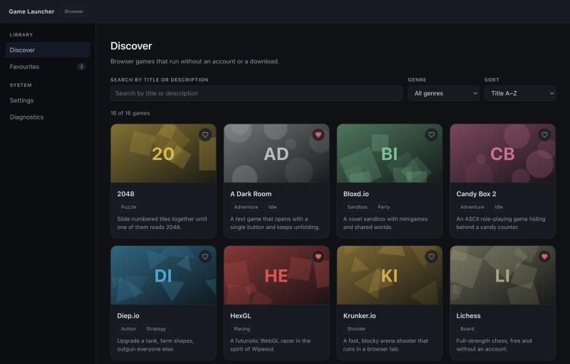
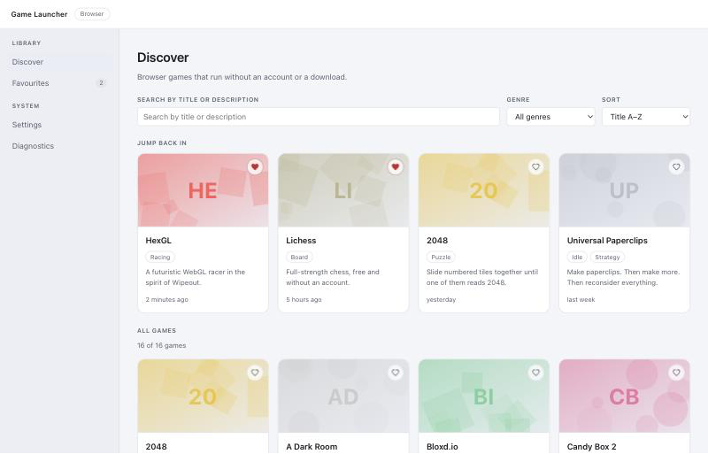
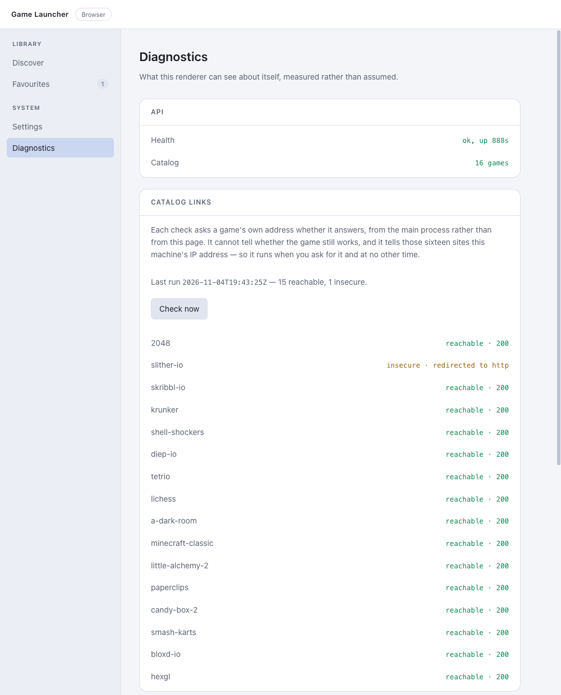

# 🎮 Game Launcher — Browser Game Catalog

A desktop application for finding and launching browser games. Browse a curated
catalog, search and filter by genre, keep favourites, pick up where you left
off, and check whether every link in the catalog still answers — all stored
locally in JSON files, with no account and no server of ours.

🔗 Download (macOS, Apple silicon): https://github.com/vadimkosenkov/angular-electron-game-launcher/releases/latest

🔗 Repository: https://github.com/vadimkosenkov/angular-electron-game-launcher

> The launcher does not install or run games. It is a catalog that hands a
> validated `https://` link to the operating system.

---

## 📸 Preview







---

## 🚀 Key Features

- Catalog of 16 browser games that run without an account or a download, each
  with genres, tags, a description and cover art generated from its own title.
- Search by title or description, filter by genre, sort by title, by year
  or by when you last played.
- Favourites, kept in a user-data file and listed in their own section.
- Play history: a "Jump back in" row of what was launched recently, timed in
  words rather than timestamps.
- Link availability checking — on request the launcher probes every address in
  the catalog and reports what answered: reachable, refused, missing, gone off
  https, or unknown.
- Diagnostics page showing the runtime versions, the security flags actually in
  force, and the result of the last link check.
- RU/EN localization for the app UI.
- Light/dark theme following the system, with a manual override.
- Favourites, history, settings and link reports persisted as JSON in the OS
  user-data directory — no backend, no account, no telemetry.

---

## 🛠️ Tech Stack

### Desktop shell

- Electron 45
- electron-builder 26

### Frontend

- Angular 22 (standalone components, signals, zoneless change detection)
- TypeScript 6
- SCSS
- Transloco (i18n)
- RxJS

### Backend

- Node.js
- Express 5
- Zod (schema validation)
- JSON file storage

---

## 📦 Install

### macOS (Apple silicon)

**1. Download the disk image**

[`game-launcher-0.9.0-arm64.dmg`](https://github.com/vadimkosenkov/angular-electron-game-launcher/releases/download/v0.9.0/game-launcher-0.9.0-arm64.dmg) — 115 MB

**2. Open it and drag Game Launcher onto Applications**

**3. Open the app once by hand — macOS will refuse the ordinary way**

The build is signed ad hoc: the signature proves the bundle has not been
altered since it was built, but it carries no Apple Developer ID, so Gatekeeper
cannot tell you who made it and declines rather than guess. Either:

- right-click the app in Finder, choose **Open**, then **Open** again in the
  dialog, or
- clear the quarantine flag yourself:

```bash
xattr -dr com.apple.quarantine "/Applications/Game Launcher.app"
```

macOS remembers the decision for that copy, so only the first launch asks.

**Verify the download if you like:**

```bash
shasum -a 256 game-launcher-0.9.0-arm64.dmg
# 310c24f3c29a9673cc49015f32130e7e7edff19f0957e693a8bc35f0253462db
```

### Other platforms

There is no Intel or Windows build. The application code is close to
portable — the user-data path and the shutdown behaviour already branch per
platform — but the window uses a macOS-only title bar style, and an NSIS
installer needs a Windows machine to build on. Until then, the way to run it
elsewhere is from source.

---

## ⚙️ Quick Start

### 1. Clone the repository

```bash
git clone https://github.com/vadimkosenkov/angular-electron-game-launcher.git
cd angular-electron-game-launcher
```

### 2. Install dependencies

```bash
npm install
```

npm 11 does not run package install scripts by default, and Electron downloads
its binary from one. If `node_modules/electron/path.txt` is missing afterwards,
fetch the binary explicitly:

```bash
node node_modules/electron/install.js
```

### 3. Start the application

```bash
npm run start:electron
```

This runs three processes together: the Angular dev server, a TypeScript watch
for the Node side, and Electron held back until both are ready.

To work on the UI in an ordinary browser instead, run the API and the dev
server separately:

```bash
npm run dev:api        # Express on 4501
npm run start:browser  # Angular on 4500
```

The renderer will be available at:

```text
http://127.0.0.1:4500
```

### 4. Build a disk image

```bash
npm run package
```

The result is `release/game-launcher-<version>-arm64.dmg`.

---

## 🔒 Security

The renderer is a browser window displaying content, so it is treated as one:

- `contextIsolation: true`, `nodeIntegration: false`, `sandbox: true`. The page
  has no Node access at all; everything it may do is listed explicitly in the
  preload script.
- Games open in the system browser through an **exact-match allow-list** built
  from the catalog file validated at startup. An address that is not in that
  list cannot be opened, whatever the page asks for.
- The Express API listens on loopback only, on a port the OS assigns, behind a
  session token generated anew on every run.
- The link checker takes no URL and no game id — there is nothing for a caller
  to point at, which is what keeps it from becoming a request-forgery hole. It
  refuses private, loopback and link-local addresses, and re-checks every
  redirect hop rather than trusting the first one.
- Every request body is validated with Zod; every write to disk is atomic and
  confined to the application's own user-data directory.
- No secrets in the source, no telemetry, no network access except the game
  sites themselves — and those only when asked.

Why each of these is there, and what they do **not** protect against, is
written out in the design notes.

---

## 📖 Documentation

[**Architecture and design notes**](docs/architecture.md) — the long version:
the process split, the preload bridge, the local HTTP server and why it is not
automatically safe, the Content Security Policy, code signing and what macOS
says about it, the storage format and how it survives a damaged file, the link
checker, and the API reference.

---

## 📄 License

MIT
