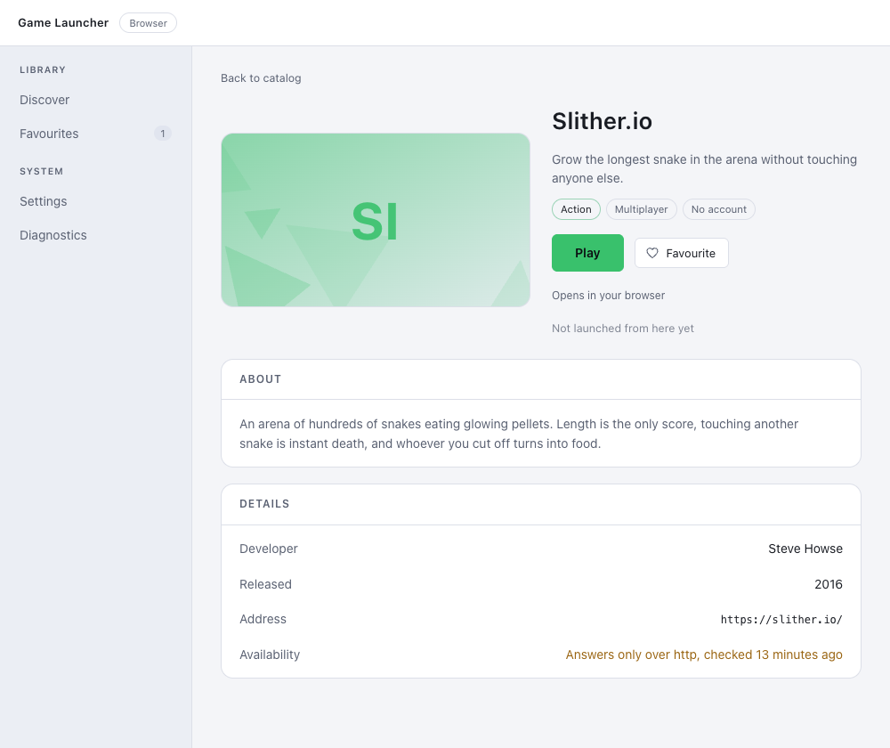

# Game Launcher

A desktop catalog of browser games: browse, search, filter, keep favourites,
open a game page, launch the game in the system browser and find your way back
to what you were playing. Built as a learning project around
**Angular 22 + Electron 45 + Express 5 + JSON storage**.

> The launcher does not install or run games. It is a catalog that hands a
> validated `https://` link to the operating system.

## Architecture

Three processes, each with one job:

| Part | Responsibility |
| --- | --- |
| **Electron main** (`electron/`) | Application lifecycle, window, local Express server, OS integration |
| **Preload** (`electron/preload.ts`) | The only bridge between Node and the page, exposed through `contextBridge` |
| **Renderer** (`src/`) | Angular UI. No Node access, talks to the API over HTTP |
| **Express API** (`server/`, from stage 3) | REST API over JSON storage |

The renderer runs with `contextIsolation: true`, `nodeIntegration: false` and
`sandbox: true`. Everything it is allowed to do is listed explicitly in the
preload script.

## Requirements

- Node.js `^22.22.3 || ^24.15.0 || >=26` (developed on 24.21)
- npm 11+
- macOS (Apple Silicon); other platforms are untested

## Setup

```bash
npm install
```

### npm 11 blocks install scripts

npm 11 does not run package install scripts by default, and Electron downloads
its binary from one. If `node_modules/electron/path.txt` is missing after the
install, fetch the binary explicitly:

```bash
node node_modules/electron/install.js
```

## Running

```bash
npm run start:electron   # Angular dev server + TypeScript watch + Electron window
npm run start:browser    # Angular dev server only, opens in the default browser
```

`start:electron` runs three processes under `concurrently`: `ng serve` on port
**4500**, `tsc --watch` for the Node side, and `wait-on` holding Electron back
until both the dev server and `dist-node/electron/main.js` exist. No `setTimeout`
is involved in the wait.

The dev server sits on 4500, and the API beside it on 4501, rather than on the
Angular default 4200, so the launcher can run alongside other local projects.
The ports live in `angular.json`, `proxy.conf.json` and `shared/dev-config.ts`
-- in configuration rather than behind a command-line flag, so they survive the
next start.

They were moved off 4300/4301 after a collision with another project on this
machine that uses 4200, 4201, 4202, 3333 and 4300. Keeping both of ours in one
contiguous block well clear of that range is what makes the next collision
unlikely; leaving the port out of `angular.json` would fall back to 4200 and
collide immediately.

It is pinned to the address `127.0.0.1`, not the name `localhost`, in both
places. On macOS `localhost` resolves to `::1` first, so a second dev server
bound to the IPv6 wildcard can take that address while ours holds the IPv4 one:
both appear to be on the same port, neither fails to start, and the window
quietly loads the wrong application. With the address named, a real collision
fails loudly with *Port 4500 is already in use*, which is what a collision
should do.

The two commands are alternatives, not a pair. Both dev modes need an API on
the fixed port **4501** -- `start:electron` starts one inside the main process,
`start:browser` expects `npm run dev:api` beside it -- and the two use different
tokens, so running both at once shows `UNAUTHORIZED: Missing or invalid session
token.` in the browser. Stop one before starting the other.

### User data directory

Electron derives the application name from the packaged bundle. Running
`electron main.js` there is no bundle, so the name falls back to `Electron` and
user data -- including the single-instance lock that lives next to it -- would
be shared with every other unpackaged Electron app on the machine. The main
process therefore names itself explicitly:

| Mode | Directory |
| --- | --- |
| development | `~/Library/Application Support/Game Launcher (dev)` |
| packaged | `~/Library/Application Support/Game Launcher` |

Development data is deliberately separate, so experiments and corrupted-file
tests never touch real favourites.

Browser-only development has no Electron to ask, so `npm run dev:api` writes to
`.dev-user-data/` in the repository instead. That directory is gitignored.

Favourites and settings live in `user-data.json` in whichever of those
directories applies. See [User data on disk](#user-data-on-disk). Link check
results live beside them in `availability.json`, which is a measurement rather
than the person's data and is treated accordingly -- see
[Link availability](#link-availability).

## Building

```bash
npm run build       # Angular bundle into dist/, Node bundle into dist-node/
```

## Packaging

```bash
npm run package       # a .dmg in release/
npm run package:dir   # the .app only, without the disk image -- faster to test
```

Both run the build and the icon generator first, so there is no way to package
a stale bundle. The result is `release/Game Launcher-<version>-arm64.dmg`,
about 115 MB, of which Electron's own framework is nearly all.

[electron-builder](https://www.electron.build/) does the work, configured in
`electron-builder.yml` rather than in a `build` key in `package.json`, so the
reasoning can live beside the settings.

### What goes in the bundle, and what the dependency split is for

electron-builder ships `dependencies` and omits `devDependencies`. That is the
whole mechanism, and it is why Angular, transloco and rxjs are listed as
development dependencies here even though the application cannot run without
them: by packaging time they are already compiled into `dist/`, and the copy in
`node_modules` would be 100 MB of source nothing reads.

What is left in `dependencies` is what the Node side still `require`s at run
time: `express`, `zod` and `tslib`. The check is worth keeping:

```bash
npx asar list "release/mac-arm64/Game Launcher.app/Contents/Resources/app.asar" | grep -c '@angular'
```

Zero. The rest of the repository -- source, scripts, screenshots, the dev
server -- is excluded by naming the three things that belong in the bundle
instead of filtering everything else out.

`npmRebuild` is off: there are no native modules, so there is nothing to
rebuild against Electron's ABI.

### Serving the renderer from inside the archive

Everything is packed into `app.asar`, including the Angular bundle that Express
serves with `express.static`. That reads from the archive without any
unpacking, because Electron patches `fs` to understand asar paths, and
`express.static` goes through `fs` like everything else. Verified rather than
assumed -- `asarUnpack` is not needed here, and was removed after checking
that the packaged renderer's JavaScript really is served:

```
GET /                  200   (with the nonce CSP header)
GET /main-<hash>.js    200   116938 bytes
GET /api/games         401   (no bridge, no token)
```

### The icon

```bash
npm run icon          # build/icon.icns and build/icon.png
```

`scripts/build-icon.mjs` draws it: a rounded blue square with a white
play triangle, in Apple's proportions, at each of the ten sizes `iconutil`
wants. Nothing is installed to do it -- a PNG is length-prefixed chunks around
zlib-compressed scanlines, and `node:zlib` is already there.

Two decisions in that script are worth the few extra lines. Each size is drawn
at its own scale rather than resampled from 1024, because at 16 pixels a
downscaled triangle is a blue smudge. And every pixel is sampled sixteen times,
so the rounded corners and the diagonal edges are smooth rather than stepped.

The generated files are gitignored: a binary nobody can diff does not belong in
the repository when a script can produce it byte for byte.

### Code signing, and what macOS will say

There is no paid Apple Developer certificate behind this project, so the
application is **ad-hoc signed**: `identity: null` tells electron-builder not
to go looking for one, and `scripts/ad-hoc-sign.mjs`, wired in through its
`afterPack` hook, seals the bundle with `codesign --sign -`.

That hook is not a formality. Without it the bundle is in a state worse than
unsigned: Electron's binary arrives carrying the ad-hoc signature its own
linker produced, while the bundle around it has no `_CodeSignature` seal at
all, and macOS reports the inconsistency as

```
code has no resources but signature indicates they must be present
```

A disk image downloaded in that state is called **damaged**, with no way for
the person to override it. With the seal in place the verdict is the ordinary
one:

```bash
spctl -a -t exec -vv "release/mac-arm64/Game Launcher.app"   # rejected
codesign -dv "release/mac-arm64/Game Launcher.app"           # Signature=adhoc
```

"Rejected" is the expected answer and is as far as this gets: `-` is not an
identity, and Gatekeeper still has no idea who built the application. What
changed is that the person can now get past it.

**Opening it the first time.** macOS says *"Game Launcher" cannot be opened
because the developer cannot be verified*, or on a downloaded copy *"Game
Launcher" is damaged* if the quarantine flag is set. Either way:

```bash
xattr -dr com.apple.quarantine "/Applications/Game Launcher.app"
```

or, without the terminal: right-click the application in Finder, choose
**Open**, and confirm once. macOS remembers the decision for that copy.

Replacing `identity: null` with a Developer ID and adding notarisation is the
only change needed to remove all of this, and the configuration is written so
that it is the only change.

## API

A local Express server on loopback. Every response is either `{ "data": ... }`
or `{ "error": { "code", "message", "details?" } }`, so the renderer never has
to guess what came back.

| Method | Path | Auth | Success | Errors |
| --- | --- | --- | --- | --- |
| `GET` | `/api/health` | none | `200` `{ status, uptimeSeconds }` | — |
| `GET` | `/api/games` | token | `200` the whole catalog | `401` |
| `GET` | `/api/games/:id` | token | `200` one game | `400` bad slug, `404` unknown id, `401` |
| `GET` | `/api/user-data` | token | `200` `{ settings, favourites }` | `401` |
| `PUT` | `/api/user-data/settings` | token | `200` the whole user data | `400` unknown language, theme or extra key, `401` |
| `PUT` | `/api/user-data/favourites/:gameId` | token | `200` the whole user data | `400` bad slug, `404` unknown id, `401` |
| `DELETE` | `/api/user-data/favourites/:gameId` | token | `200` the whole user data | `400` bad slug, `404` unknown id, `401` |
| `POST` | `/api/user-data/history/:gameId` | token | `200` the whole user data | `400` bad slug, `404` unknown id, `401` |
| `DELETE` | `/api/user-data/history` | token | `200` the whole user data | `401` |
| `GET` | `/api/availability` | token | `200` the stored link check results | `401` |
| `POST` | `/api/availability/check` | token | `200` the whole new report | `401` |

Anything else under `/api` answers `404` with a JSON body rather than Express's
default HTML page.

Every write answers with the whole of the user's data rather than the part it
touched. It is a few dozen bytes, and it means the renderer replaces its state
with the server's answer instead of merging into it.

`PUT` and `DELETE` on a favourite are idempotent: adding one twice, or removing
one that was never there, succeeds and writes nothing. Recording a launch is
the one route that is deliberately not -- sending it twice means the game was
launched twice, which is the whole point of it, so it is a `POST` rather than a
verb that would be promising something false.

### Why a local HTTP server is not automatically safe

A server bound to `127.0.0.1` is reachable by every process running as this
user, and by every page open in the user's browser: a web page can send
requests to loopback addresses. The launcher therefore does not treat
"it is local" as "it is private".

- **Loopback only.** `127.0.0.1`, never `0.0.0.0`, which would publish the API
  to the local network.
- **Random port** in production, assigned by the operating system via
  `listen(0)`. Weak on its own, but it raises the cost of finding the server.
- **Session token.** A random token per run, generated by the main process and
  handed to the renderer through the preload bridge, required on every route
  but health. It travels in a custom header, which a browser cannot send
  cross-origin without a preflight request.
- **No CORS headers, in any mode.** The preflight above is therefore never
  answered, so a page on an unrelated site cannot even phrase a request to the
  API. The renderer is same-origin instead: a packaged launcher is served by
  this very server, and in development the Angular dev server proxies `/api`
  (see below).
- **Host header check** against loopback names, which defeats DNS rebinding.
- **Origin allow-list.** Requests with no `Origin` (the window itself, curl)
  pass this check and are stopped by the token instead.
- **Same-origin requests are allowed explicitly.** Same-origin is not the same
  as origin-less: a `<script type="module">` is always fetched in CORS mode,
  even by the page that references it, so in a packaged launcher the renderer's
  own bundle arrives carrying an `Origin` header. Without that branch the
  application serves its own `index.html` and then refuses to serve its own
  JavaScript. The origin is compared against the `Host` header, already checked
  to be loopback, because the port is only known at startup.
- **32 kB JSON body limit** and `x-powered-by` disabled.

### Content Security Policy

The packaged renderer is served with a policy that allows no inline script and
no inline style, and `connect-src 'self'` keeps a compromised page from talking
to any other host.

Two things had to change to make a policy that strict possible, and both are
worth knowing:

- Angular's production build inlines critical CSS together with a small inline
  `onload` handler, which would force `'unsafe-inline'` in `script-src` -- the
  exact hole the policy exists to close. `inlineCritical` is therefore off in
  `angular.json`.
- Angular injects component styles as `<style>` elements while the application
  runs, which a strict `style-src` rejects. Rather than allowing every inline
  style with `'unsafe-inline'`, the server generates a fresh nonce per response
  and substitutes it into `index.html`; Angular reads the `ngCspNonce`
  attribute on `<app-root>` and stamps that nonce onto the elements it injects.
  This is why `index.html` cannot be served by `express.static` and why the
  document is sent with `Cache-Control: no-store`.

In development the page comes from the Angular dev server, which sends no
policy, so the `__CSP_NONCE__` placeholder reaches the browser literally and is
inert. The policy is exercised in a production run and when packaged.

### Opening a game in the system browser

The only thing the launcher does outside its own window, and the only place a
compromised renderer could do real damage, so the decision is not made there.

The renderer asks; the **main process decides and acts**. It checks the address
against the catalog it validated at startup -- an exact-match set of the
`playUrl` values -- and opens nothing else:

| Asked for | Result |
| --- | --- |
| `https://play2048.co/` (in the catalog) | opened |
| `https://evil.example/` | rejected |
| `javascript:alert(1)` | rejected |
| `file:///etc/passwd` | rejected |
| `https://play2048.co/?x=1` (one character off) | rejected |
| `42` (not a string) | rejected |

An exact-match set rather than a host or prefix rule: a prefix would let a
crafted path through, and there is no reason to accept anything but the
addresses that ship with the application. Every refusal is logged by the main
process.

The IPC argument is typed `unknown` on arrival, because a compromised renderer
can invoke the channel with anything at all. The game's address is shown on its
page as plain text rather than as a link, so the button is the only way out.

### When something goes wrong

A packaged application has no terminal attached. Everything it knows about its
own failures goes nowhere unless it is written down, which is exactly the build
where it matters.

**The log file.** `electron/logger.ts` wraps `console.debug/log/info/warn/error`
so that every line also lands in a file:

| Mode | File |
| --- | --- |
| development | `~/Library/Application Support/Game Launcher (dev)/logs/main.log` |
| packaged | `~/Library/Application Support/Game Launcher/logs/main.log` |

The console is wrapped rather than replaced by a logger threaded through every
module, and that is deliberate: the Express server never imports Electron --
that independence is what lets it run under plain `node` -- so it cannot be
handed a logger that knows where Electron keeps user data. Wrapping the console
captures its output, and node's own, without any module knowing.

Appends are synchronous. The lines worth having are the last ones before a
crash, and those are precisely the ones a buffered writer loses; at a handful
of lines per run the cost is not worth measuring. The file rotates at 512 kB,
keeping one `main.previous.log`, and a log that cannot be written is swallowed
rather than allowed to become the thing that breaks the application.

**A crash in the main process.** `uncaughtException` means the process that
owns the window, the API and the user's data is in a state nobody reasoned
about, so the launcher says so in a dialog, names the log file and exits with
code 1. Carrying on would mean an application that half works.

An unhandled promise rejection is logged but does not quit. Most of them are
one failed operation rather than a broken process, and quitting over one would
be a worse bug than the one being reported.

**A crash in the renderer.** `render-process-gone` leaves a blank window and
`unresponsive` leaves the last frame it painted -- from the outside both look
like an application that has simply frozen. Both are named in a dialog that
offers the one action that helps:

| Event | Dialog |
| --- | --- |
| `render-process-gone` | *The window stopped running.* — **Reload** / Quit |
| `unresponsive` | *The window is not responding.* — **Keep waiting** / Reload |

Reloading loses nothing: favourites and settings are on disk, not in the page.

These dialogs are in English while the rest of the interface is translated.
They come from the main process, which has no access to the dictionaries and
may have to speak before the renderer -- the thing that knows the chosen
language -- exists at all.

### Interface language

Interface labels go through [transloco](https://jsverse.github.io/transloco/);
the dictionaries are `src/app/core/i18n/en.ts` and `ru.ts`.

Two decisions worth knowing:

- **TypeScript, not JSON.** `ru.ts` declares itself as `Translations`, the type
  derived from `en.ts`, so a key added to one and forgotten in the other fails
  to compile instead of surfacing as a raw key in the interface.
- **No HTTP loader.** Transloco fetches `/assets/i18n/<lang>.json` by default.
  The dictionaries are imported instead, which makes the switch synchronous,
  removes a request that could fail in a packaged application, and keeps
  `connect-src` free of an entry it does not need.

The catalog's own prose is separate: `summary` and `description` carry both
languages in the data, because they are content rather than translations of the
interface. `LanguageService` answers "which language is active" for both.

The switch is on the settings page, and the choice is saved: `LanguageService`
derives the active language from the stored settings rather than holding a
signal of its own, so there is one fact in one place instead of a copy on each
side.

### User data on disk

Favourites and the two settings live in one small JSON file, written by the
server and never by the renderer:

```json
{
  "settings": { "language": "ru", "theme": "system" },
  "favourites": ["hexgl", "2048"],
  "history": [
    { "gameId": "hexgl", "launchCount": 12, "lastPlayedAt": "2026-11-02T15:01:03.681Z" },
    { "gameId": "2048", "launchCount": 9, "lastPlayedAt": "2026-11-01T15:01:23.681Z" }
  ]
}
```

**Why not `localStorage`.** It is scoped to an origin, and in production the
launcher's origin includes a port the operating system hands out fresh on every
start. Favourites kept there would appear to vanish at each launch. A file in
the user-data directory does not care what port the server got.

**Favourites are ids, not copies.** The catalog decides what a game is; this
list only points at it. A title corrected in a later version shows corrected
here, with no migration, and an id for a game that was dropped from the catalog
is discarded when the file is read.

**A damaged file is repaired, not refused.** The catalog aborts startup if its
file is wrong, because serving half a catalog is worse than not starting. User
data gets the opposite treatment: the person's favourites exist nowhere else,
so every field that can be salvaged is, and only the unreadable parts fall back
to a default. A file that is not JSON at all is moved to
`user-data.json.corrupt-<timestamp>` rather than overwritten -- it may still be
recoverable by hand, and silently replacing it is the one failure nobody could
undo.

| What the file holds | What happens |
| --- | --- |
| nothing (first run) | defaults; no file is written until something changes |
| not JSON at all | moved aside, defaults loaded, warning logged |
| an unknown language or theme | that field falls back, the rest is kept, warning logged |
| a favourite that is not a game | that entry is dropped, the rest is kept |
| a history entry that is malformed, duplicated or for an unknown game | that entry is dropped, the rest is kept |
| a history in the wrong order | sorted back into order on read |
| cannot be read at all (permissions, I/O) | startup fails loudly |

That last row is deliberate and is the one case that does stop the launcher. A
file we cannot read is not a file we know to be damaged: starting with defaults
would leave the next write free to replace data that was probably still intact.
Refusing to start is recoverable; overwriting is not.

**Writes are atomic**, here and for the link check results beside them --
`server/storage/json-file.ts` holds the one copy. `writeFile` straight onto the
real path is not atomic: a crash partway through leaves a truncated file. Each
write goes to `user-data.json.<random>.tmp` and is then `rename`d over the target, which
within one filesystem replaces it in a single step -- a reader sees the old
contents or the new ones, never half of each. The temporary file is removed if
the rename fails. What this does not do is `fsync` the directory, so a power
cut in the seconds after a write can still lose that change; a file that is
never corrupt is the part worth paying for, an fsync per click is not.

**Nothing from a request reaches the path.** The directory is handed to the
server at startup and the file name is a constant. There is no `..` to filter,
because there is nothing to concatenate -- which is a stronger guarantee than
sanitising a name correctly every time.

**The settings are read before anything renders.** Bootstrap waits for them,
alongside the session token it already waited for. A write to the settings
replaces the whole object, so a renderer that had not finished reading would
send a default back in the field the user did not touch and overwrite the
saved value with it -- loading first removes that window instead of narrowing
it, and the interface is never briefly in the wrong language or theme. If the
read fails outright the settings controls are disabled until a retry succeeds,
because writing over values we never managed to read is the one thing that
loses them. Favourites are unaffected either way: they are changed one id at a
time, so the server merges rather than replaces.

**The renderer guesses, the server decides.** Pressing a heart fills it at
once and sends the request afterwards. If the write fails the shell shows a
banner and the interface falls back; on success the server's own answer
replaces the guess, which is also how the renderer learns the resulting order.
Waiting for a round trip to a server on this machine would make every heart
feel slow to protect against a case that ends in an error message either way.

**It falls back to the last answer, not to the last screen.** Those differ
exactly when two guesses overlap: the second one captures the first one's
guess as its "before", so restoring that would leave a rejected change on
screen once both writes fail -- press two hearts in the same moment against a
read-only directory and one of them stays filled over a file that has
neither. The last confirmed state is the only thing the renderer knows to be
true, so that is what it goes back to. The cost is a guess still in flight
disappearing for a moment when an unrelated one fails, which the arrival of
its own answer undoes.

**One question at a time.** Every write is answered with the whole of the
user's data, which is what spares the renderer from merging -- and is exactly
why two of them must not overlap. Two writes can easily be in flight at once:
a heart pressed while a launch is being recorded, say. They travel on separate
connections, so nothing makes the answers come back in the order the questions
were asked, and the older snapshot landing last would quietly undo the newer
change on screen although the server had already written it to disk. Worse,
the requests themselves can arrive inverted, and then the server commits the
newer intent first and the older one last, so the *file* ends up holding the
change the person made first.

Dropping stale answers in the renderer would only fix the first of those. So
the renderer sends one request at a time instead, through a promise chain --
the request is built when the person acts and sent when the one ahead of it
has answered. That is the same thing the server does with its own writes, for
the same reason, and both problems stop existing rather than being detected: a
queued request costs the round trip in front of it, which to a server on this
machine is milliseconds, and the guess is on screen the whole time anyway.
Reproduced by delaying one answer in the renderer -- the second request was
not sent until the first had landed -- and the read-only-directory case
re-checked the same way.

### Play history

The launcher counts the games it opened, so the catalog can lead with what you
were last playing rather than with the alphabet.

**A record per game, not an entry per launch.** This is the decision the rest
of the feature follows from. An event log would grow without bound, and nobody
has ever wanted to read the four-thousandth line of one; two numbers --
`launchCount` and `lastPlayedAt` -- answer both questions the interface asks,
in space bounded by the size of the catalog. A timeline would be a different
feature with a different shape, not a bigger version of this one.

**An array, not an object keyed by game id.** A JSON object read from a file
the person can edit is an object with keys somebody else chose, and
`__proto__` among them is a class of bug this shape simply does not have. The
order is the one the interface wants -- most recently played first -- so it is
maintained by moving the record to the front on each write rather than by
sorting on read.

**The stored shape grew without a migration.** A file written by the previous
version has no `history` key at all, and that is not an error: the schema's
`.catch` on every field covers a missing one exactly as it covers an invalid
one, so an older file loads with its settings and favourites intact and an
empty history beside them. There is no migration script and no version number,
because the loader already had to tolerate a file it did not write.

**Only a launch that happened is counted.** The main process is the one that
decides whether an address may be opened; the renderer counts the launch only
after being told the address was actually opened. A refused or failed launch
is not a game that was played, and counting the press rather than the result
would make the number mean nothing in exactly the cases worth knowing about.

A compromised renderer could still inflate its own counter, and that is an
acceptable thing for it to be able to do -- the number is the person's own,
and the decision that matters, which address the operating system is handed,
was never the renderer's to make.

One honest caveat: in the browser-only development mode there is no main
process, so `window.open` stands in for it. With `noopener` set it returns
`null` whether or not the page opened, so a popup the browser blocked still
counts as a launch there. A packaged launcher never takes that branch.

**The write is not optimistic.** Favourites fill the heart first and ask the
server afterwards, because a heart that waits for a round trip feels slow.
Nobody is watching a counter when they press Play -- the game has just opened
in another window -- so the launch is sent, and the number changes when the
server says it changed. There is nothing to guess and therefore nothing to
roll back.

**"3 days ago" is computed, not stored.** `RelativeTimeService` wraps
`Intl.RelativeTimeFormat`, which produces "yesterday" and "на прошлой неделе"
in the active language without a plural rule written anywhere in this project.
It is a service rather than a pipe for two reasons: it reads the language
signal, so every `computed` that calls it re-runs on a switch, where a pure
pipe would keep the old wording until its input happened to change; and it
reads a clock signal that advances once a minute, so a label left on screen
ages instead of insisting it is still "now" an hour later.

The one place the catalog's own labels do count things -- "Launches: 12" --
says it with a colon rather than an agreeing noun. Russian needs three forms
where English needs two, `Intl.PluralRules` would supply them, and the typed
dictionaries would then need `few` and `many` keys in English that English
never asks for. A label that reads correctly for every number is worth more
than the machinery to decline one.

**Clearing it.** The settings page can forget the whole history, behind a
confirmation, because it is the only control in the application that destroys
something. The confirmation is a second press rather than a system dialog: it
keeps the answer next to the question and does not block the window to ask.
Forgetting one game is not offered -- a route nobody calls is a route nobody
keeps correct.

### Link availability

The catalog promises sixteen working links. This is how the launcher checks
whether that is still true, and how it says so without claiming more than it
knows.


**The check runs in Node, not in the page.** A renderer cannot do this at all:
it could not read a cross-origin response without CORS headers those sites have
no reason to send, the Content-Security-Policy restricts `connect-src` to this
origin on purpose, and handing the page outbound access to sixteen third-party
hosts is exactly what that policy exists to prevent. Node has no origin, no
cookie jar and no cache, so what comes back is the answer to the question
actually asked.

**Nothing is ever checked automatically.** Each run tells sixteen other
people's servers this machine's IP address and the fact that somebody here
opened a game launcher. That is reasonable when the person asks for it and not
reasonable behind their back on every start, so the only thing that starts a
run is the button on the diagnostics page. Opening a game page reads the stored
result; it never produces a new one.

**The endpoint takes no parameter of any kind.** Not a URL, not even a game id.
An endpoint that accepted one would be a handler that fetches an address chosen
by its caller, which is the shape of every server-side request forgery there
has ever been -- and on a loopback API the caller is a browser displaying
content from the web. The renderer can say "check the catalog", and the catalog
is the file the server validated at startup.

**A redirect is also input, and that one was missed first time round.** No URL
reaches the checker from the renderer, which looked like the end of the
question and was not: a `Location` header is a URL chosen by whoever answered.
A catalog host that redirected to `http://127.0.0.1:9200/` would have the
launcher probe whatever is listening there and print the result -- open, or
refused -- in its own interface. A port scanner with a button, driven from
outside. Browsers have private-network rules for this; Node has none.

So redirects are followed by hand, at most five hops, and every hop is looked
at before it is requested: the first address as well as each `Location`,
because a catalog hostname could equally resolve somewhere local. An address
is refused when it is loopback, private, link-local (which includes the cloud
metadata address `169.254.169.254`), carrier-grade NAT, unspecified or
multicast, whether it is written as a literal, spelled `localhost`, wrapped in
IPv6 (`::ffff:7f00:1` is `127.0.0.1` wearing a coat) or arrived at through DNS
-- a name is refused if *any* address it resolves to is non-public. The refusal
is reported as `unknown`, because the check genuinely did not finish.

What this does not do is pin the connection to the address it checked. Between
that lookup and the one `fetch` makes, a name under someone else's control can
answer differently -- DNS rebinding. Closing it would mean dialling a literal
address while carrying the original name in the `Host` header and the TLS
handshake: a custom dispatcher's worth of machinery for a launcher that checks
sixteen links on a button press. The redirect itself, which is the part an
outside server actually controls, is covered.

**Five states, and none of them is "works".** The launcher is not the game and
cannot know whether a page that loads is playable, so every state describes the
response instead:

| State | Meaning | From |
| --- | --- | --- |
| `reachable` | answered over https, below 400 | `2xx`, `3xx` |
| `insecure` | answered, but only after leaving https | a redirect to `http` |
| `refused` | answered, and turned this client away | `401`, `403`, `407`, `429` |
| `missing` | the address itself is gone | `404`, `410` |
| `unknown` | the check did not finish | timeout, DNS or TLS failure, `5xx` |

`refused` is not `missing` on purpose. A site that declines an automated
request is up, and nothing follows from that about the game in a real browser;
calling it broken would be inventing a fact. For the same reason `unknown`
stays `unknown` -- a timeout may be the site or may be this machine's network,
and the launcher cannot tell which.

**It says who it is.** The request carries
`User-Agent: GameLauncher (desktop launcher; link availability check)` rather
than a borrowed browser string. Impersonating a browser would get past more of
these sites, and the number it would improve is one this feature reports to the
user as fact.

**What the first run found.** Fifteen of the sixteen answered `200` over https.
`slither.io` answers `302` to `http://slither.io/?a` -- the catalog's address is
https, the site immediately drops to http, and no amount of care on this side
changes that. It is reported as `insecure` rather than quietly as fine. The
launcher still only ever hands an `https://` address to the operating system;
what the site does with it afterwards is the site's choice, and now a visible
one.



**A 404 outranks the scheme.** An answer is only downgraded to `insecure` when
it would otherwise have been `reachable`. A `404` served over http is still a
`404`, and reporting the scheme instead would hide the more useful of the two
facts behind the less useful one.

**A redirect off https is not followed at all.** It is already the answer --
the catalog promises https and the address does not keep the promise -- and
following would mean this machine making a plain http request to a third party
to learn something it already knows. The reported status is then the redirect's
own (`302` for `slither.io`), because that is the response the launcher
actually saw.

**HEAD first, then GET.** `HEAD` costs no body. Several sites have never been
asked a `HEAD` question and answer it badly -- `405` by the book, `403` or `501`
in practice -- while serving the same address to `GET` without complaint, so
those three statuses are retried once with `GET` and the body is cancelled
before it is read. Four requests run at a time, each with an eight-second
timeout: sixteen at once is unkind to a laptop on hotel wifi and makes every
timeout fire together, one at a time would take the worst case past two
minutes. The real catalog takes about four seconds.

**The results are not the person's data.** They live in `availability.json`,
separate from `user-data.json`, and the two files are treated as the different
things they are. A damaged report is discarded rather than quarantined, because
the recovery is to press the button again; a damaged `user-data.json` is kept
for inspection, because favourites are not recoverable from anywhere else. A
report that could not be written is still shown, for the same reason in
reverse: the measurement genuinely happened, and all a lost file costs is one
press after the next start. Entries are salvaged one at a time, so a report
written when the catalog had one more game loses that row and keeps the rest.

**A second press joins the first run.** Two clicks are a person being
impatient, not a reason to ask sixteen strangers' servers twice.

### Theme

Three choices -- system, light, dark -- stored as one of those three words, not
as a resolved colour.

`system` means "ask the operating system and keep asking": `ThemeService`
reads `prefers-color-scheme` and listens for changes, so a launcher left open
across the moment macOS switches appearance follows it. The resolved answer is
written to `<html data-theme>`, and `src/styles.scss` defines the colour tokens
twice, once under each value. No component has a light-mode branch; they all
read the same custom properties.

The bare `:root` block covers the paint before Angular has started at all, and
it is the dark palette -- a light-mode user sees one dark frame rather than a
flash of white. By the time the first component renders the stored preference
has already been read, so the theme does not change under them.

### Cover art

The covers are generated, not downloaded. Real cover art belongs to the people
who made the games, so none of it is shipped here.

Each cover is drawn as inline SVG from the game's own data: the seed is its id,
so a cover never changes between renders or sessions, the palette comes from
`accentColor`, and the shape of the pattern comes from the first genre -- which
is what keeps sixteen generated covers from reading as one repeated texture.

A game may instead carry `coverUrl`, a path relative to the Angular assets
folder, and that image wins over anything generated. Drop a file in
`src/assets/` and point the catalog entry at it.

### Checking the API without Electron

```bash
npm run dev:api
```

Serves the same API on a fixed port 4501 with a fixed development token, so it
can be exercised directly:

```bash
curl http://127.0.0.1:4501/api/health
curl -H "x-launcher-token: dev-session-token" http://127.0.0.1:4501/api/games
curl -H "x-launcher-token: dev-session-token" http://127.0.0.1:4501/api/user-data
curl -X PUT -H "x-launcher-token: dev-session-token" \
  http://127.0.0.1:4501/api/user-data/favourites/hexgl
```

Those writes land in `.dev-user-data/user-data.json`, so the file can be
inspected, damaged on purpose and watched being repaired.

The browser-only development mode does not call that port. `proxy.conf.json`
makes the Angular dev server forward `/api` to it, so the page sees the API at
its own origin:

```bash
curl -H "x-launcher-token: dev-session-token" http://127.0.0.1:4500/api/games
```

Without the proxy the page would be making a cross-origin request carrying a
custom header, the browser would send a preflight, and the preflight would be
refused -- which is exactly the behaviour the production setup depends on.
Proxying keeps development same-origin, like production, instead of weakening
the server to accommodate it.

The server module never imports Electron. It receives its port, token, catalog
path and user-data directory as arguments, which is what makes this possible
and what the browser-only development mode relies on.

## Project layout

```
electron/   Electron main process and preload script
shared/     Types shared between the Node side and Angular
server/     Express API, routes, middleware, the catalog and the user's data
src/app/
  core/     Services with no interface of their own: API client, bridge,
            catalog store, user data, link availability, i18n, theme
  features/ One folder per page: discover, favourites, game, settings,
            diagnostics
  shared/   Components used by more than one page
```

`shared/` is imported as `@shared/*` from Angular and through relative paths
from the Node side: `tsc` does not rewrite path aliases when it emits CommonJS,
while the Angular bundler does.
